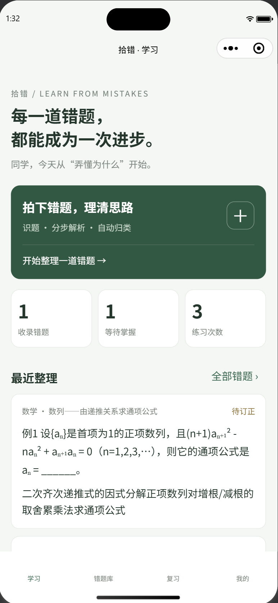
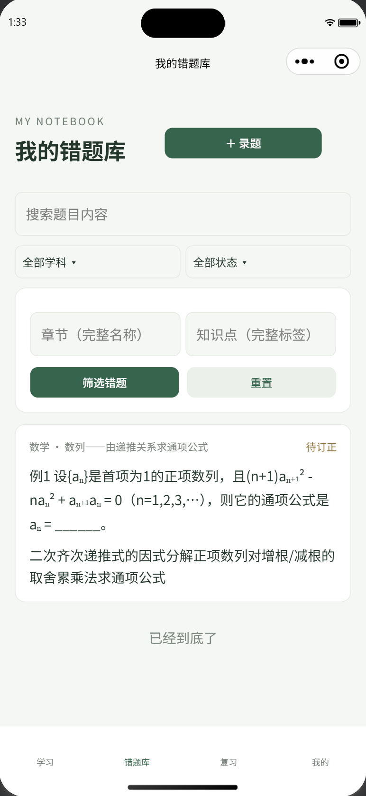
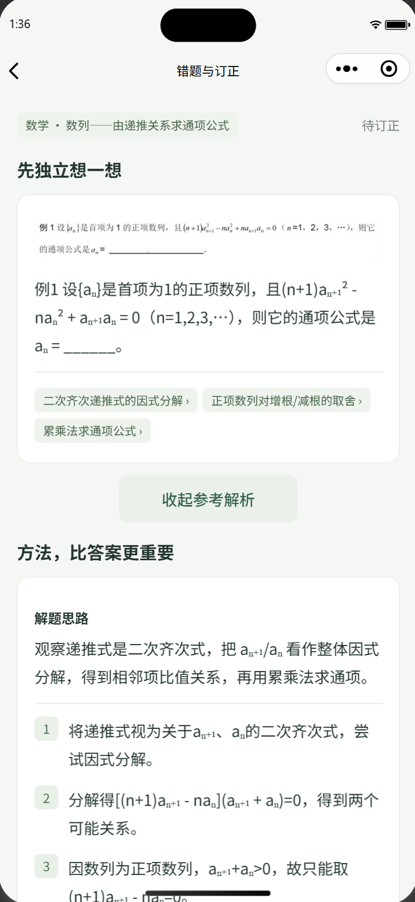
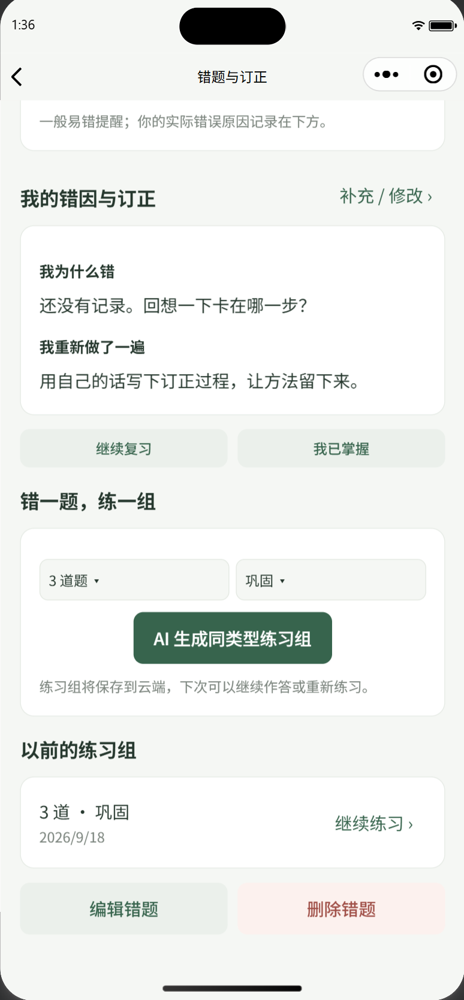
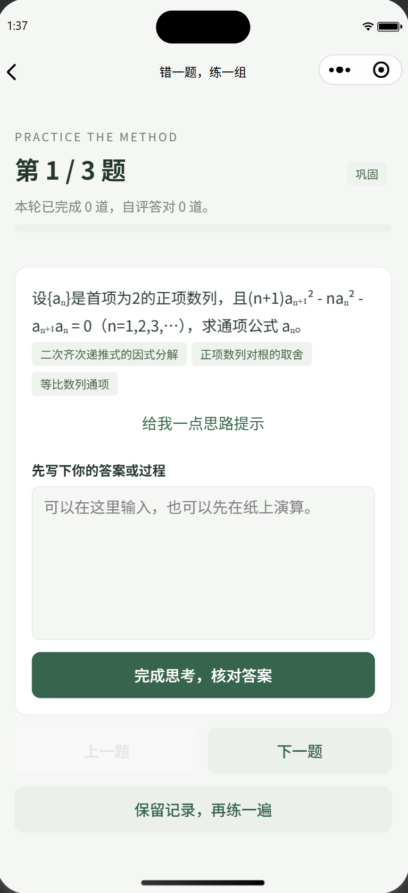
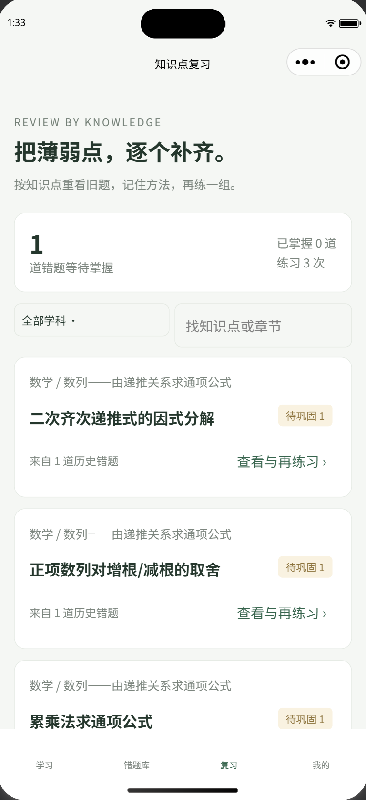
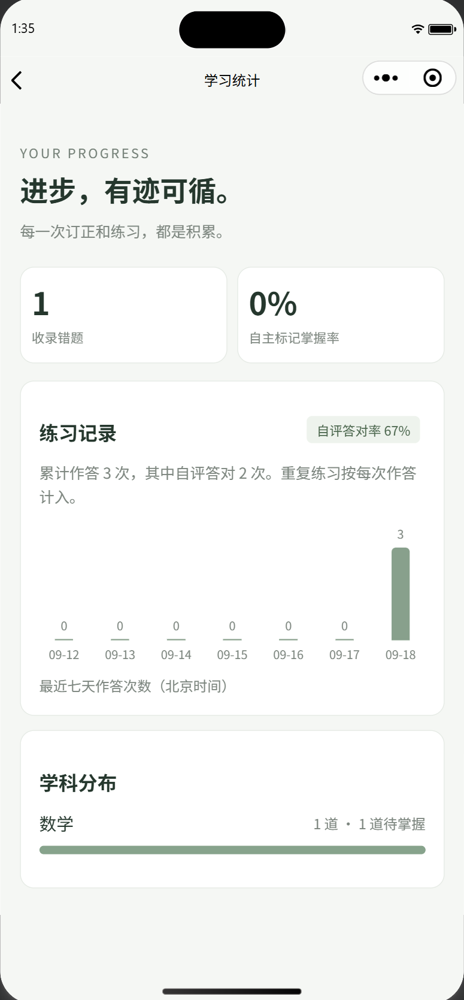
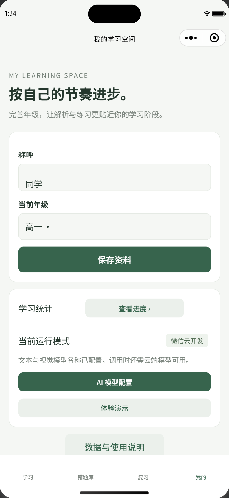
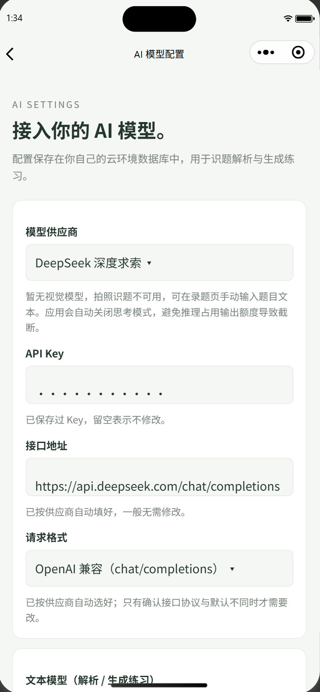

# 拾错 · AI 智能错题学习小程序

面向中学生的**原生微信云开发小程序**：拍照或手动录入错题，AI 识别题目并给出分步解析，学生记录错因与订正结果，再按知识点归类、生成同类型练习、按历史曲线复习，形成"识题 → 理解 → 订正 → 再练 → 复习"的完整学习闭环。

## 界面预览

| 学习首页 | 错题库 | 错题解析 |
| --- | --- | --- |
|  |  |  |

| 生成练习 | 练习题组 | 复习 |
| --- | --- | --- |
|  |  |  |

| 学习统计 | 我的 | 模型配置 |
| --- | --- | --- |
|  |  |  |

## 立即打开

1. 微信开发者工具导入**本项目根目录**，不是单独导入 miniprogram 目录。
2. 复制 `project.config.example.json` 为 `project.config.json`，并将其中的 `你的小程序AppID` 替换为自己的小程序 AppID。项目配置已指定小程序目录 `miniprogram/` 和云函数目录 `cloudfunctions/`。
3. 尚未填入云环境时，学习首页显示配置提示。点击“先体验本地演示”，可以完整体验预置题目、手工录题、订正、筛选、练习和统计。
4. 演示模式显著标注“预置示例与本机数据，不调用真实 AI”。数学、物理、英语各有一题及一组示例练习。自录题不会被套用无关示例，图片识别与真实 AI 生成需使用云开发模式。
5. 演示与云端数据完全分开。“我的”可切回云开发或仅重置演示数据。

## 接入你的云环境

### 1. 环境 ID

在 `miniprogram/config.js` 填入你的微信云开发环境 ID：

```js
module.exports = {
  cloudEnv: '你的云环境ID',
  functionName: 'notebook'
}
```

使用与 AppID 关联的微信云开发环境，修改配置后重新编译。如果此前进入了演示，在“我的”点击“返回云开发”。

### 2. 建立数据库集合

在云开发控制台创建以下七个集合，名称必须一致（云端函数也会在写入前自动创建缺失集合）：

| 集合 | 用途 |
| --- | --- |
| profiles | 微信身份对应的称呼和年级 |
| mistakes | 原题、学科、章节、知识点标签、分步解析、易错点、实际错因、订正结果、掌握状态 |
| media | 题目图片的上传凭证、所属用户和云存储 fileID |
| practice_sets | 原题关联的 3/5 道练习、提示、答案和步骤 |
| practice_records | 每轮每题的答案、自评结果和时间 |
| ai_usage | 按用户和北京时间日期统计 AI 请求次数 |
| ai_settings | 每个用户的 AI 模型配置：供应商、模型名、接口地址、请求格式（OpenAI / Anthropic 兼容）与 Key |

集合权限统一设置为**仅管理端可读写**，对应 `cloud/database.rules.json`：

```json
{ "read": false, "write": false }
```

客户端通过 notebook 云函数操作数据库。云函数从 `cloud.getWXContext().OPENID` 取得身份，不接受客户端传入的身份，所有资源操作都验证归属。数据库权限模型参考 [腾讯云开发安全规则](https://docs.cloudbase.net/rule/rule-example)。

### 3. 云存储权限

设置为**仅创建者可读写**，使用 `cloud/storage.rules.json`。客户端先申请绑定当前用户的上传路径，再上传图片并提交 fileID；服务器核对路径与归属后才允许识别。规则参考 [云存储安全规则](https://docs.cloudbase.net/storage/security-rules)。

图片压缩后限制为 3 MB，只接受 JPG / PNG。原图存云存储，数据库只存 mediaId / fileID，不存 Base64。只有点击“AI 分析”时才把图片发送给已配置的模型。

### 4. 索引

索引清单在 `cloud/database.indexes.json`，它是**供控制台逐项配置的清单，不是自动导入脚本**。

优先建立：
- mistakes_filter_0：个人错题分页列表。
- mistakes_summary：知识归类与学习统计。
- practice_sets_by_mistake：原题的历史练习组。
- practice_records_by_set、practice_records_by_owner：继续练习和统计。

其余 mistakes_filter_1 至 mistakes_filter_15 覆盖学科、章节、知识点和状态的任意组合筛选。按实际需要创建；如果控制台提示缺少索引，按错误提示与清单补齐对应字段顺序。索引全部为非唯一；`_id` 的内置唯一索引由数据库提供。

### 5. 部署云函数与模型

右键 `cloudfunctions/notebook` → **上传并部署：云端安装依赖**。云函数运行时使用 Node.js 18 或更高版本，控制台将超时时间设置为 **60 秒**，内存建议从 **512 MB** 开始。模型内部请求在 45 秒超时时给出可重试提示，函数超时时間仍需在控制台确认，不能只依赖本地 config.json；开发者工具「本地调试」云函数超时固定 20 秒，长耗时的识题请求请走云端调用。

云函数使用 `wx-server-sdk@4.0.2` 操作微信云开发，使用 `@cloudbase/node-sdk@3.18.3` 的 AI SDK 调用模型。已提供 package-lock.json。

在 CloudBase 控制台开通需要的模型，在云函数环境变量配置：

| 变量 | 说明 |
| --- | --- |
| AI_PROVIDER | 文本模型提供方标识，默认 cloudbase |
| AI_TEXT_MODEL | 必填，已启用的文本模型名称，用于文本题分析和练习生成 |
| AI_VISION_PROVIDER | 视觉模型提供方标识，默认沿用 AI_PROVIDER |
| AI_VISION_MODEL | 必填，已启用且支持图片输入的视觉模型，用于拍照识题 |
| AI_DAILY_LIMIT | 每人每日 AI 请求次数，默认 30，范围 1–100；失败请求也计入 |

**文本模型并不一定支持图片。** 视觉模型必须支持 image_url 类型的多模态输入与 data URL 图片。若使用自定义提供方，在 CloudBase 模型管理中配置其 Base URL / API Key，再填入对应提供方标识。凭据留在云端，不写入小程序包。模型名称没有写死，避免使用已下线或未开通的模型。初始化和消息格式见 [CloudBase Node AI SDK 文档](https://docs.cloudbase.net/ai/model/nodejs-access)。

.env.example 仅作说明，不会自动加载，真实值需设置在云函数环境变量中。

### 6. 真机验收

部署后重新编译，切到云开发模式，依次检查：
1. 首次进入创建个人资料，云错题库为空，不自动写入演示题。
2. 拍摄完整单题，上传、识别，核对题干、解题思路、分步解析、答案和标签。
3. 补充实际错因与订正结果，保存后从错题库打开。
4. 按学科、章节和知识点筛选；编辑题目，确认保存。
5. 从原题生成 3 道或 5 道练习，写答案、查看解析、自评结果。
6. 中途退出再打开同一练习组，恢复本轮进度；完成后再练一轮，历史记录保留。
7. 查看知识点复习和统计；用另一个微信账号确认看不到第一位用户的记录。
8. 上线前按微信后台要求完成该小程序实际使用能力对应的用户隐私保护指引，并核对模型服务的可用性和应用审核要求。

## 功能说明

- **学习首页**：最近错题、录题入口、收录量与练习量。
- **错题库**：关键词搜索，学科、章节、知识点与掌握状态组合筛选，分页加载。
- **拍照 / 手动录题**：图片压缩上传、AI 识题与归类、可编辑解析、本机草稿。
- **错题详情**：先思考再展开答案；解题思路、编号步骤、一般易错点、学生实际错因及订正结果分开展示。
- **练习组**：3/5 道题、基础/巩固/提高难度、思路提示、逐题答案与解析、记录自评、多轮练习。
- **知识点复习**：按学科与知识点检索，查看所属章节、相关错题数量和未掌握数量。
- **统计**：错题学科分布、掌握率、最近七天练习次数、自评答对率。
- **资料**：称呼与年级，不要求输入邮箱或密码。

“已掌握”和练习对错均由学生自主标记，不是 AI 自动判卷结果。AI 会尽量返回可读的数学符号；目前展示为原生文本，没有实现完整 LaTeX 排版或几何交互画板。

## 工程结构

```text
miniprogram/
  pages/             8 个原生页面
  components/        模式提示、错题卡片
  utils/             云调用、图片处理、校验、演示数据
  config.js          云环境 ID
cloudfunctions/notebook/
  index.js           微信身份入口与错误封装
  service.js         错题、练习、统计业务
  repository.js      云数据库查询与事务
  ai.js              可配置 AI SDK、提示词、超时
  validation.js      输入与 AI 结构校验
cloud/               数据库 / 存储规则与索引清单
tests/               服务、SDK 适配与页面流程测试
scripts/             静态检查、微信官方编译检查
assets/              界面截图（README 引用）
```

## 验证命令

本地 Node.js 18+：

```powershell
npm test
npm run check
node scripts/compile-wechat.cjs
```

前两项不需要额外安装测试依赖。编译脚本默认使用当前电脑安装的微信官方 wcc.exe / wcsc.exe，其他电脑可把编译器目录作为脚本参数传入。

测试覆盖身份隔离、图片归属、乐观锁、幂等保存、练习重复提交、统计、分页、AI 异常，以及从录题到多轮练习的页面逻辑流程。此类测试和离线编译不等同于云端联调或真机验证。

## 数据维护与边界

删除错题采用软删除，关联练习随后不可访问，并从用户统计排除；不直接清空云端图片或历史记录。未使用的上传凭证与原图、已删除题目的数据需按实际运营保留策略在管理端清理。草稿和未提交练习输入留在本机，以运行模式与微信资料 ID 隔离；已提交结果在云端保存。

当前统计会分页读取当前用户的数据，适合个人错题本规模。大规模运营时应增加统计汇总表和维护任务。本项目未包含广告、支付、教师管理、自动评分、分享他人错题和订阅消息。
